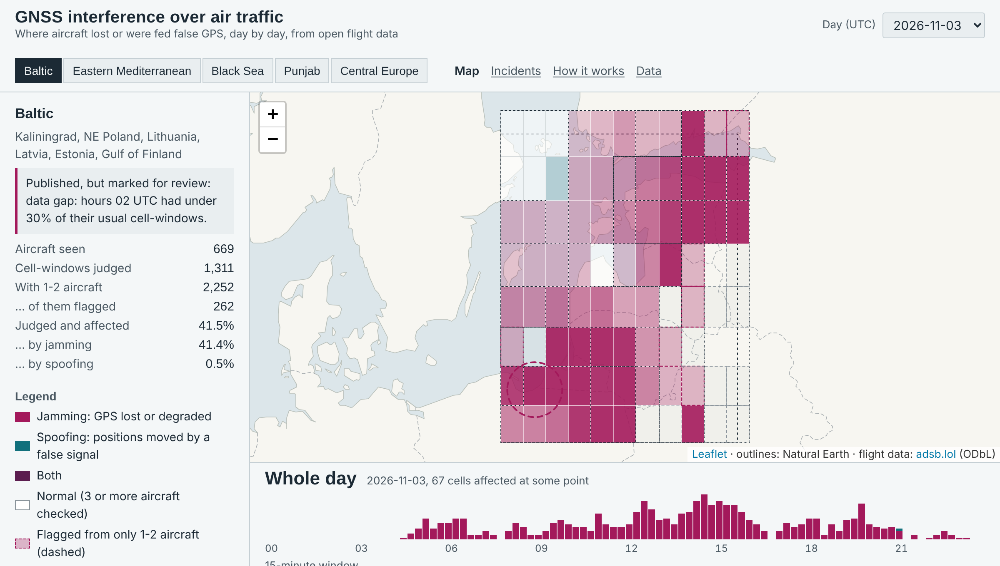
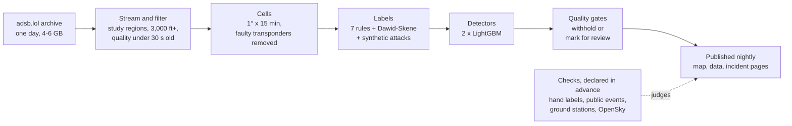

# gnssguard: GNSS interference detection from open ADS-B data

[](https://doi.org/10.5281/zenodo.24015200)

A daily map of where aircraft lose trustworthy GPS (jamming) or are fed false positions
(spoofing), built only from free, open flight data, with the evidence for every flag
and an honest statement of how far to trust it.

**Live map, incident pages and open data: https://sahilprg.github.io/gnss-interference/**
(updated every night).



> Research project. Not for navigation or operational decisions. A flag means aircraft
> reported degraded or inconsistent positions there, not who or what caused it.

## The problem

GPS interference around conflict zones (the Baltic, the Black Sea, the Eastern
Mediterranean, the India-Pakistan border) now affects thousands of flights a day, and
aviation authorities, India's DGCA among them, have issued advisories. Every aircraft
with ADS-B broadcasts how much it trusts its own GPS position (NIC, NACp). When many
aircraft in one place report low integrity, or impossible motion, at the same time,
that is a navigation anomaly consistent with interference. gnssguard turns one day of the open
[adsb.lol](https://www.adsb.lol) archive into that picture: per 1° cell and 15-minute
window, jamming, spoofing, normal, or not enough aircraft to say.

## Three numbers, with their limits

| Result | What it shows | What it does not show |
| --- | --- | --- |
| Of the public interference events, the event day **stands out against the same area on ordinary days for 2** (Kaliningrad spoofing, Mar 2025; Gdansk Bay jamming, May 2025), plus the two Delhi spoofing events (against only 7 ordinary days) and one partly (western Black Sea, Nov 2026); 14 of 15 are "found" (3 or more matching cells) | Where the map's flags rise on a reported day | That most events were unusual: near Kaliningrad jamming is routine, so "found" there means little. One miss (Kaliningrad, Nov 2024) |
| A **second receiver network** (OpenSky) confirms **70-84%** of jamming cells outside the Baltic, and flags 0.2% (calm Central Europe) to 9.3% (Black Sea) of the cells the model calls normal; the Baltic reaches 73% once both count the same aircraft | The data handling holds up against independent receivers and decoding | The physics: both networks hear the same aircraft. The declared check failed (60% pooled) and is published as failed |
| **Sealed test** (250 cells, 5-18 Nov 2026, drawn and scored exactly as declared in advance): the model finds **56%** of interference, a simple NIC-share rule **74%**; both raise almost no false alarms. **The model fails its declared gate** | Flags are precise (99% are interference) and spoofing is caught (13 of 15 flagged, 11 named) | That the learned model adds anything: it reproduces the rules, whose thresholds are too strict. One labeler, 15% unsure |

**The honest result:** the model is trained on labels made by readable rules and, on the
sealed test, flags exactly what they flag. A one-line rule (flag a cell when a quarter of
its aircraft report degraded integrity) found more interference; the model's advantage
is only on simulated attacks. So since 0.3.0 **the map's label comes from the rules**
plus that integrity rule, with a "possible" state for single degraded aircraft; the
model's scores stay as an experimental layer. That rule was chosen after the sealed test,
so it is tested again, declared in advance, on 1-14 Dec 2026. The strength of the
project is
the pipeline and the evaluation discipline: every check is declared before its data is
seen, failed checks are published, and `gnssguard benchmark` regenerates the main
tables with hashes (not yet every number; see the roadmap). The sealed test's scoring
code and one primary endpoint were archived before the draw
([doi:10.5281/zenodo.24073541](https://doi.org/10.5281/zenodo.24073541)); its result,
including a scoring bug found afterwards and corrected in the open, is in
[the evaluation protocol](docs/evaluation_protocol.md#sealed-test-result-labeled-by-sp-scored-once-on-28-nov-2026).
Full results and limits: [docs/evidence.md](docs/evidence.md).

## How it works



The raw archive is streamed and never stored (about 130 MB kept per day). Only
cell-level aggregates are published, never aircraft identifiers.

## Documentation

| Read | For |
| --- | --- |
| [docs/evidence.md](docs/evidence.md) | Every result and limit, with the full tables |
| [docs/case_studies.md](docs/case_studies.md) | Delhi spoofing (found), Kaliningrad Nov 2024 (missed), the Baltic in two networks (failed check) |
| [docs/evaluation_protocol.md](docs/evaluation_protocol.md) | Each check as declared before its data, then its result |
| [docs/model_card.md](docs/model_card.md), [docs/model.md](docs/model.md) | Intended use, training, ablations |
| [docs/data.md](docs/data.md), [docs/labels.md](docs/labels.md) | The archive, the point format, the rules and the hand-labeling protocol |
| [docs/product.md](docs/product.md) | The nightly job, published files, quality gates, monitoring |
| [docs/roadmap.md](docs/roadmap.md), [CHANGELOG.md](CHANGELOG.md) | What is done, what is open, and the correction after the 7 Nov 2026 review |
| [docs/development.md](docs/development.md) | Installing, running on a laptop, repository layout |

## Quickstart

```bash
git clone https://github.com/sahilprg/gnss-interference
cd gnss-interference
pip install -e ".[dev,fast]" -c constraints.txt   # exact tested versions
make test                      # unit tests, no network
make sample DATE=2026-10-26    # first 5,000 aircraft of one day, about 2 min
```

More, including disk and download sizes: [docs/development.md](docs/development.md).

## How to cite

Every release is archived on Zenodo; [doi:10.5281/zenodo.24015200](https://doi.org/10.5281/zenodo.24015200)
always resolves to the latest. The archived steps of the sealed test, each with a public
date: the model, 0.2.0 ([doi:10.5281/zenodo.24015201](https://doi.org/10.5281/zenodo.24015201), 6 Nov 2026); the protocol and
scoring code before the draw, v0.2.1-protocol ([doi:10.5281/zenodo.24073541](https://doi.org/10.5281/zenodo.24073541), 9 Nov); the
result, 0.2.1 ([doi:10.5281/zenodo.24624935](https://doi.org/10.5281/zenodo.24624935), 28 Nov).
GitHub's "Cite this repository" button uses `CITATION.cff`:

> sahilprg. *gnssguard: GNSS interference detection from open ADS-B data* (2026).
> https://github.com/sahilprg/gnss-interference. Daily data:
> https://sahilprg.github.io/gnss-interference/, derived from adsb.lol under ODbL 1.0.

## License

Code: MIT. Input data: adsb.lol, [ODbL 1.0](http://opendatacommons.org/licenses/odbl/1.0/);
derived data is published under ODbL with attribution ([DATA_LICENSE.md](DATA_LICENSE.md)).
Second-network check: OpenSky Network (Schäfer et al., IPSN 2014); no raw OpenSky data is
redistributed.
