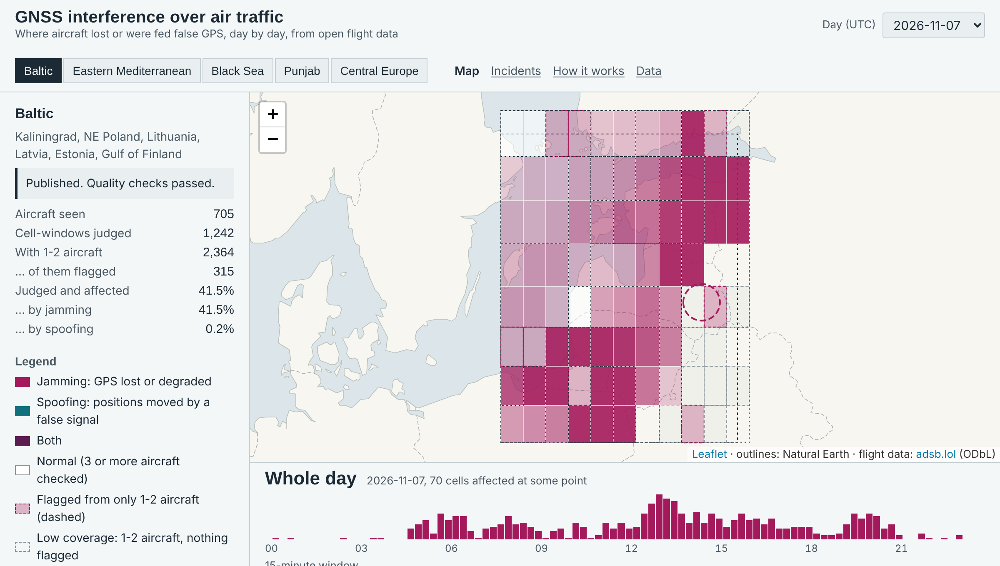
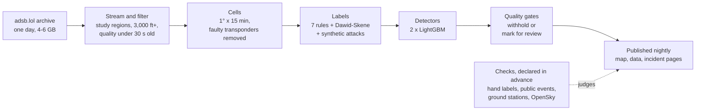

# gnssguard: GNSS interference detection from open ADS-B data

[](https://doi.org/10.5281/zenodo.24015201)

A daily map of where aircraft lose trustworthy GPS (jamming) or are fed false positions
(spoofing), built only from free, open flight data, with the evidence for every flag
and an honest statement of how far to trust it.

**Live map, incident pages and open data: https://sahilprg.github.io/gnss-interference/**
(updated every night).



> Research project. Not for navigation or operational decisions. A flag means aircraft
> reported degraded or inconsistent positions there, not who or what caused it.

## The problem

GPS interference around conflict zones (the Baltic, the Black Sea, the Eastern
Mediterranean, the India-Pakistan border) now affects thousands of flights a day, and
aviation authorities, India's DGCA among them, have issued advisories. Every aircraft
with ADS-B broadcasts how much it trusts its own GPS position (NIC, NACp). When many
aircraft in one place report low integrity, or impossible motion, at the same time,
something on the ground is interfering. gnssguard turns one day of the open
[adsb.lol](https://www.adsb.lol) archive into that picture: per 1° cell and 15-minute
window, jamming, spoofing, normal, or not enough aircraft to say.

## Three numbers, with their limits

| Result | What it shows | What it does not show |
| --- | --- | --- |
| **14 of 15** checkable public interference events found (95% interval 70-99%), all 4 backed by ground radio measurements | The map's flags fall where and when incidents were reported | That the day was unusual: near Kaliningrad jamming is routine. One miss (Kaliningrad, Nov 2024) |
| A **second receiver network** (OpenSky) confirms **70-84%** of jamming cells outside the Baltic and flags 2-5% of normal ones; the Baltic reaches 73% once both count the same aircraft | The data handling holds up against independent receivers and decoding | The physics: both networks hear the same aircraft. The declared check failed (60% pooled) and is published as failed |
| On hand-labeled cells, the model finds **86%** of interference, a NIC-share baseline 76%, a **GPSJam-style** NACp score **45%** | NIC and motion checks catch what a NACp-only map misses, spoofing included | A real-world rate: development samples, one labeler. The sealed test (19 Nov 2026) decides |

**The honest caveat:** the model is trained on labels made by readable rules, and on real
data it reproduces them (on 1 Nov they disagreed on 1 of 6,542 judged cells). Its
advantage so far is on simulated attacks the rules miss. The strength of the project is
the pipeline and the evaluation discipline: every check is declared before its data is
seen, failed checks are published, and every number is regenerated with hashes by
`gnssguard benchmark`. Full results and limits: [docs/evidence.md](docs/evidence.md).

## How it works



The raw archive is streamed and never stored (about 130 MB kept per day). Only
cell-level aggregates are published, never aircraft identifiers.

## Documentation

| Read | For |
| --- | --- |
| [docs/evidence.md](docs/evidence.md) | Every result and limit, with the full tables |
| [docs/case_studies.md](docs/case_studies.md) | Delhi spoofing (found), Kaliningrad Nov 2024 (missed), the Baltic in two networks (failed check) |
| [docs/evaluation_protocol.md](docs/evaluation_protocol.md) | Each check as declared before its data, then its result |
| [docs/model_card.md](docs/model_card.md), [docs/model.md](docs/model.md) | Intended use, training, ablations |
| [docs/data.md](docs/data.md), [docs/labels.md](docs/labels.md) | The archive, the point format, the rules and the hand-labeling protocol |
| [docs/product.md](docs/product.md) | The nightly job, published files, quality gates, monitoring |
| [docs/roadmap.md](docs/roadmap.md), [CHANGELOG.md](CHANGELOG.md) | What is done, what is open, and the correction after the 7 Nov 2026 review |
| [docs/development.md](docs/development.md) | Installing, running on a laptop, repository layout |

## Quickstart

```bash
git clone https://github.com/sahilprg/gnss-interference
cd gnss-interference
pip install -e ".[dev,fast]" -c constraints.txt   # exact tested versions
make test                      # unit tests, no network
make sample DATE=2026-10-26    # first 5,000 aircraft of one day, about 2 min
```

More, including disk and download sizes: [docs/development.md](docs/development.md).

## How to cite

Release 0.2.0 is archived on Zenodo ([doi:10.5281/zenodo.24015201](https://doi.org/10.5281/zenodo.24015201)),
before the sealed test, so the model and the scoring rules are fixed with a public date.
GitHub's "Cite this repository" button uses `CITATION.cff`:

> sahilprg. *gnssguard: GNSS interference detection from open ADS-B data* (2026).
> https://github.com/sahilprg/gnss-interference. Daily data:
> https://sahilprg.github.io/gnss-interference/, derived from adsb.lol under ODbL 1.0.

## License

Code: MIT. Input data: adsb.lol, [ODbL 1.0](http://opendatacommons.org/licenses/odbl/1.0/);
derived data is published under ODbL with attribution ([DATA_LICENSE.md](DATA_LICENSE.md)).
Second-network check: OpenSky Network (Schäfer et al., IPSN 2014); no raw OpenSky data is
redistributed.
